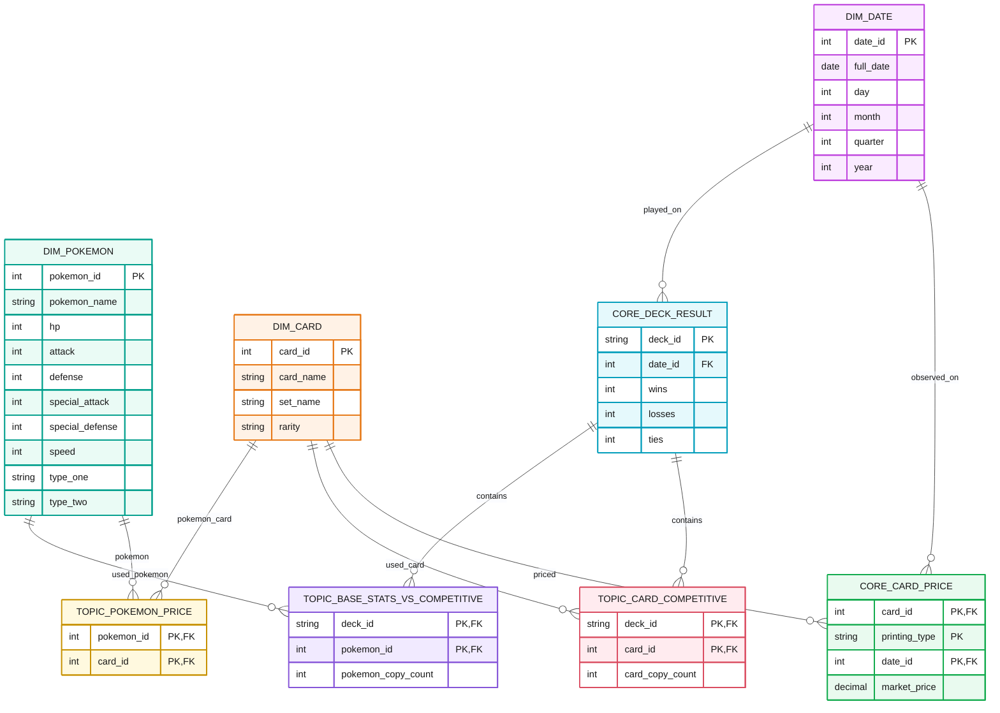

# Core-Layer

## Entity-Relationship-Diagramm der Core-Schicht

Das folgende Diagramm zeigt die Beziehungen zwischen den drei Topic-Tabellen, den gemeinsam genutzten Core-Tabellen und den Dimensionstabellen.



## Topic-Tabellen

Für jedes der 3 Analyseszenarios wird jeweils eine Topic-Tabelle angelegt. Da zwischen den Topics 
Überschneidungen existieren, haben wir sowohl aus Perfomance-Gründen, als auch um Duplizierungen
von Daten zu vermeiden, entschieden `CORE`-Tabellen zu benutzen.

Dadurch ergeben sich folgende `TOPIC`-Tabellen:

```text
TOPIC_BASE_STATS_VS_COMPETITIVE
--------------------------------
deck_id                 PK, FK
pokemon_id              PK, FK
pokemon_copy_count
```

```text
TOPIC_POKEMON_PRICE
--------------------------------
pokemon_id              PK, FK
card_id                 PK, FK
```

```text
TOPIC_CARD_COMPETITIVE
--------------------------------
deck_id                 PK, FK
card_id                 PK, FK
card_copy_count
```

Beim erzeugen dieser Tabellen musste ein Matching von Namen von Pokemon-Karten mit den Namen von 
Pokemon im Spiel hergestellt werden. Dabei waren vor allem Namenszusätze wie "Ex", "Lv.99", "V" nach 
oder Trainernamen oder ähnliches vor einem Pokemonnamen zu beachten.

## Core-Tabellen

Es ergeben sich zwei `CORE`-Tabellen, die jeweils Daten zu zwei Topics enthalten.

Zu `TOPIC_BASE_STATS_VS_COMPETITIVE` und `TOPIC_CARD_COMPETITIVE`:

```text
CORE_DECK_RESULT
--------------------------------
deck_id                 PK
date_id                 FK
wins
losses
ties
```

Zu `TOPIC_POKEMON_PRICE` und `TOPIC_CARD_COMPETITIVE`:

```text
CORE_CARD_PRICE
--------------------------------
card_id                 PK
printing_type           PK
date_id                 PK, FK
market_price
```

## Dimensions-Tabellen

```text
DIM_POKEMON
--------------------------------
pokemon_id              PK
pokemon_name
hp
attack
defense
special_attack
special_defense
speed
type_one
type_two
```

Beim Befüllen dieser Tabelle war es notwendig, einen Join aus den Tabellen `P_type` 
und `P_pokemon_type` aus dem Staging zu machen, und eine Reihenfolge der entdeckten 
Typen festzulegen.

```text
DIM_DATE
--------------------------------
date_id              PK
full_date
month_day
week_day
month
year
```

```text
DIM_CARD
--------------------------------
card_id              PK
card_name
rarity
```
