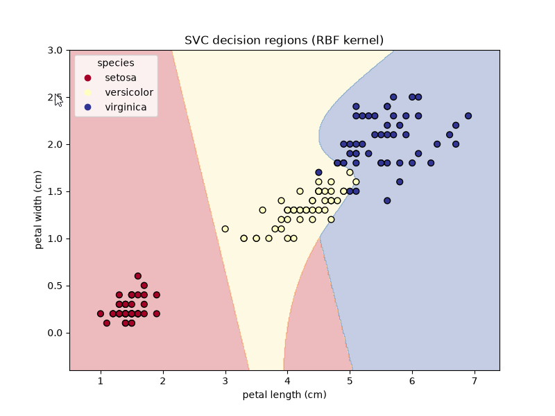
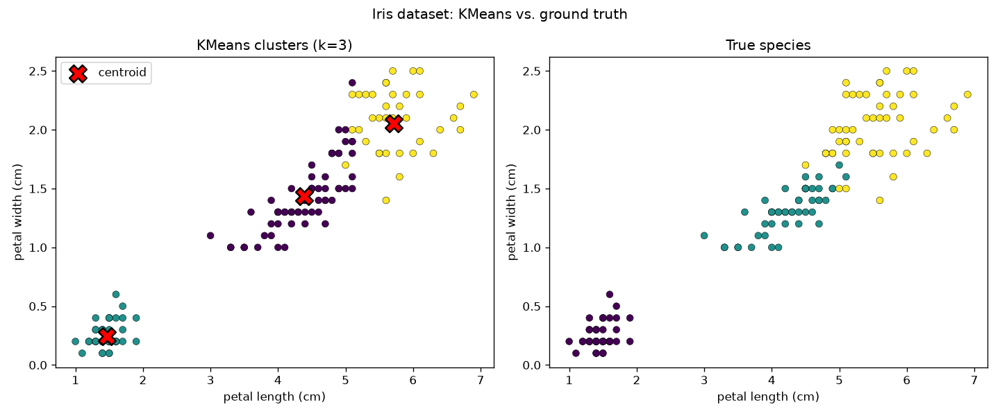

# 1 Anwendung im Data Warehouse
## 1.1 Generelle Einordnung
### 1.1.1 **Supervised Learning:** 

Vorhersagen und Klassifizierung (basierend auf bekannten Zielwerten) 

### 1.1.2 **Unsupervised Learning:** 

Gruppen/Muster/Zusammenhänge erkennen (die man vorher nicht kennt) 

### 1.1.3 **Regression:** 

Vorhersage anhand historischer Daten (z.B Umsatz, Nachfrage, Verkaufszahlen) 

### 1.1.4 **Decision Tree, Random Forest:** 

DT: ein Entscheidungsbaum → Entscheidung anhand von festen Regeln RF: Kombinationen mehrerer Entscheidungsbäume → robuster als Decision Tree 

### 1.1.5 **SVM:** 

Klassifizierung anhand von Grenzen (z.B, Funktion), vor allem auch hochdimensional 

Mobilfunkunternehmen können mit einem „Support Vector Machine“-Modell Kunden identifizieren, die nach Ablauf der Mindestvertragslaufzeit ihren Vertrag kündigen, und können dann mit Rabattaktionen den Kunden möglichst versuchen am Unternehmen zu binden. Ebenso können Kunden erkannt werden, bei denen es sinnvoller ist, sie nicht auf das Ende der Vertragslaufzeit hinzuweisen, (weil es eben genau dann dazu kommen kann, dass sie kündigen,) um sie als Dauerkunden zu behalten. 

Bedingungen: 

- sinnvolle Messwerte 

- historische Daten 

### 1.1.6 **Naive Bayes:** 

nutzt (bedingte) Wahrscheinlichkeiten für Klassifizierung (Satz von Bayes), z.B Textklassifizierung in positiv/negativ 

### 1.1.7 **K-Means-Algorithmus:** 

Versuch, Klassen zu identifizieren, die vorher nicht festgelegt sind; z.B. Klassifizierung von Kunden nach hoher Einkaufswert, billige Produkte, Produktgruppen 

### 1.1.8 **PCA (Principle Component Analysis):** 

Reduktion der Anzahl von Merkmalen, bleibt dabei möglichst genau; erfasst vor allem lineare Zusammenhänge; Beispiel: 1000 Kundenmerkmale, davon aber vielleicht nur wenige relevant bzw. viele voneinander abhängig → Ermittlung der wichtigen Merkmale 

### 1.1.9 **T-SNE (T-distributed Stochastic Neighbor Embedding):** 

Reduktion auf zwei- bzw dreidimensionale Visualisierung, dabei möglichst Erhalt von Nachbarschaften (hauptsächlich Visualisierung, eher weniger für tatsächliche Klassifizierung) 

### 1.1.10 **Apriori algorithm:** 

Erkennung von häufig gemeinsamen Merkmalen (Kunden die A kauften, kauften häufig auch B) Beispiel Amazon: 

Vorschlagen von häufig zusammen gekauften Artikeln 

Bedingungen: 

Datenbank über Kundenkäufe 

selten wechselnde Produkte (ergibt nur Sinn, wenn Produkte über einen längeren Zeitraum verfügbar sind, andernfalls würden Empfehlungen auf nur wenigen Datensätzen basieren) 

### 1.1.11 **Welche Möglichkeiten bietet ein Data Warehouse, die Arbeitsschritte Data Collection, Data Cleaning, Feature Engineering und Exploratory Data Analysis zu unterstützen?** 

_Data Collection:_ 

In der Staging Area werden Daten aus unterschiedlichen Quellsystemen extrahiert und zusammengeführt. 

_Data Cleaning:_ 

Nach dem Staging werden Daten transformiert, themenspezifisch gegliedert, normalisiert (z.B. Stuttgarter Str. einheitlich in Stuttgarter Straße) sowie Bewegungsdaten mit Stammdaten verknüpft. Die Daten werden dabei in ihre Bestandteile zerlegt (z.B. Adressen in Straße, Hausnummer, etc.) und auf Plausibilität geprüft (z.B. ob Postleitzahl zur angegebenen Stadt passt). So können auch fehlerhafte, unvollständige oder doppelt auftretende Datensätze erkannt und behandelt werden. 

_Feature Engineering:_ 

Ziel des Feature Engineering ist aus vorhandenen Daten neue Merkmale für die Analyse zu erzeugen. Im Data Warehouse geschieht dies vor allem durch die Berechnung neuer Kennzahlen und die Kombination von Daten aus verschiedenen Relationen. 

#### _Exploratory Data Analysis (EDA):_ 

EDA dient der Untersuchung von Daten, der Erkennung von Mustern und dem Verstehen von Zusammenhängen. Im Data Warehouse kann dies durch Datenzusammenführung ermöglicht werden, wobei Daten über einen bestimmten Zeitraum, eine Region oder verschiedene Kundengruppen betrachtet werden. 


## 1.2 **Unsere Beispiele:**
---

Wir haben uns bei Supervised-Learning für die Support Vector Machine entschieden und bei Unsupervised-Learning für K-Means. 
In beiden Beispielen wurde der Iris-Datensatz (Schwertlilien) benutzt - einmal mit der Ergebnis-Spalte für SVM und ohne in K-Means. Unsere Beispiel-ML-Implementierungen:


### 1.2.1 Support Vector Machine
[machine_learning/svc.py](machine_learning/svc.py): Erstellt eine Support Vector Machine mit einem Polynom von Grad 13. Daher könnte es beim Start etwas laden. Nachdem die SVC erstellt wurde, wird der Nutzer im Terminal aufgefordert Beispiel-Blütenlängen einzugeben, welche folgend mithilfe der Support Vector Machine zugeordnet werden.
Ein Beispielaufruf sieht wie folgt aus: 
```bash
$ cd machine_learning
$ uv run python svc.py
     Sepal Length  Sepal Width  Petal Length  Petal Width
0             5.1          3.5           1.4          0.2
1             4.9          3.0           1.4          0.2
2             4.7          3.2           1.3          0.2
3             4.6          3.1           1.5          0.2
4             5.0          3.6           1.4          0.2
..            ...          ...           ...          ...
145           6.7          3.0           5.2          2.3
146           6.3          2.5           5.0          1.9
147           6.5          3.0           5.2          2.0
148           6.2          3.4           5.4          2.3
149           5.9          3.0           5.1          1.8

[150 rows x 4 columns]

Enter 4 measurements in cm (or q to quit)
sepal length in cm: 4
sepal width in cm: 3
petal length in cm: 2
petal width in cm: 2
  predicted species: setosa  (class 0)

Enter 4 measurements in cm (or q to quit)
sepal length in cm: q
```
Das Output zeigt zuerst den Original-Datensatz der Schwertlilien. Folgend, nachdem die SVC erstellt wurde, 
wird der Nutzer nach Beispieldaten abgefragt. Folgend wird der eingegebene Datensatz mithilfe der SVC der jeweiligen
Klasse zugeordnet: `predicted species: setosa  (class 0)`.


Die SVC aus dem Beispiel mit Polynom-Grad 13 sieht grafisch dargestellt wie folgt aus:


Hierbei sollte jedoch beachtet werden, dass das nur eine 2D-Darstellung ist, wir allerdings vier Blumenattribute haben. 
Daher die scharfen kannten, da wir hier ein 2D-Abbild aus dem eigentlichen 4D-Kernel-Space "rausschneiden". 

### 1.2.2 K-Means

[machine_lerning/kmeans.py](machine_lerning/kmeans.py): Erstellt ein K-Means-Cluster des bereits erwähnten Iris-Datensatz, wobei dem Algorithmus jedoch nicht das Ergebnis gegeben wird.
Zum Verständnis des Outputs ist folgender Hinweis relevant: 
Im Datensatz aus den 150 Blumen-Einträgen kommen Sequenziell zuerst 50 Blüten der Klasse "Setosa", dann 50 der Klasse "Versicolor" und schlussendlich 50 der Klasse "Virginica" - sie sind also nicht zufällig verteilt.
Ein Aufruf des Programmes:
```bash
$ cd machine_learning
$ uv run python kmeans.py
     sepal length  sepal width  petal length  petal width
3             4.6          3.1           1.5          0.2
4             5.0          3.6           1.4          0.2
..            ...          ...           ...          ...
145           6.7          3.0           5.2          2.3
146           6.3          2.5           5.0          1.9
147           6.5          3.0           5.2          2.0
148           6.2          3.4           5.4          2.3
149           5.9          3.0           5.1          1.8

[150 rows x 4 columns]
[1 1 1 1 1 1 1 1 1 1 1 1 1 1 1 1 1 1 1 1 1 1 1 1 1 1 1 1 1 1 1 1 1 1 1 1 1
 1 1 1 1 1 1 1 1 1 1 1 1 1 2 0 2 0 0 0 0 0 0 0 0 0 0 0 0 0 0 0 0 0 0 0 0 0
 0 0 0 2 0 0 0 0 0 0 0 0 0 0 0 0 0 0 0 0 0 0 0 0 0 0 2 0 2 2 2 2 0 2 2 2 2
 2 2 0 0 2 2 2 2 0 2 0 2 0 2 2 0 0 2 2 2 2 2 0 2 2 2 2 0 2 2 2 0 2 2 2 0 2
 2 0]

Enter 4 measurements in cm (or q to quit)
sepal length in cm: 4
sepal width in cm: 3
petal length in cm: 2
petal width in cm: 2
  predicted species: setosa  (class 1), result=array([1], dtype=int32)

Enter 4 measurements in cm (or q to quit)
sepal length in cm: q 
```
Auch hier wird zuerst wieder der Datensatz mithilfe von Pandas ausgegeben. Das dient der späteren Eingabe, damit man Beipsieldaten zu den Blüten sieht, da sich aus unserer Gruppe - wenig überraschend - niemand so gut auskennt, dass er 
anhand der Blütenform eine Schwertlilien-Klasse zuordnen könnte. Folgend kommt das Output, wie die K-Means Cluster erstellt wurden:
```
[1 1 1 1 1 1 1 1 1 1 1 1 1 1 1 1 1 1 1 1 1 1 1 1 1 1 1 1 1 1 1 1 1 1 1 1 1
 1 1 1 1 1 1 1 1 1 1 1 1 1 2 0 2 0 0 0 0 0 0 0 0 0 0 0 0 0 0 0 0 0 0 0 0 0
 0 0 0 2 0 0 0 0 0 0 0 0 0 0 0 0 0 0 0 0 0 0 0 0 0 0 2 0 2 2 2 2 0 2 2 2 2
 2 2 0 0 2 2 2 2 0 2 0 2 0 2 2 0 0 2 2 2 2 2 0 2 2 2 2 0 2 2 2 0 2 2 2 0 2
 2 0]
 ```
Wie erwähnt: der Original-Datensatz hat immer 50 Einträge einer Klasse am Stück. Mithilfe von K-Means 
werden sehr ähnliche Cluster gebildet. 0, 1 und 2 sind dabei die Cluster-Klassen, da der Algorithmus 
die tatsächlichen Klassennamen nicht kennt. Es gibt ein einigen Punkten kleine Abweichungen, da nicht strikt 
nach 50 Einträgen einer Klasse 50 Einträge der nächsten folgen, sondern es gibt immer einen gewissen kurzen Übergang und somit falsche Zuordnungen - aber damit war zu rechnen. Letztendlich wird der Nutzer wirder nach Beispielen abgefragt und das Programm mappt 0, 1 und 2 programmatisch wieder zu den Klassennamen.

Grafisch kann das K-Means Cluster aus der Beispieldatei wie folgt dargestellt werden:



Auch hier sind die paar wenigen falschen Zuordnungen gut erkennbar - ebenso wie die grundlegend richtig erstellten drei Cluster.
