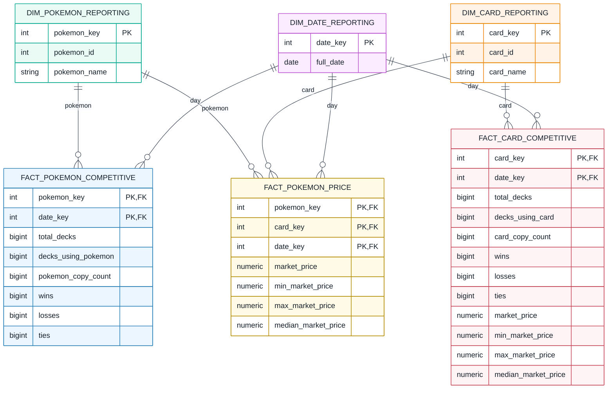

# Reporting-Layer

## 1. Sinn und Zweck der Reporting-Schicht

Der **Reporting-Layer** macht die Informationen für konkrete Analysefragen direkt auswertbar. Dazu werden komplexe Verknüpfungen aus dem Core bereits bei der Datenbefüllung vorgenommen und Ergebnisse auf die benötigte Granularität verdichtet.

Die Aufgabenstellung verlangt im **Business-Schema** die Umsetzung von Star-Schemas und die **Ersetzung natürlicher Schlüssel durch künstliche Schlüssel**. Im vorliegenden Projekt werden aufgrund der drei Analysefragestellungen drei miteinander verbundene Star-Schemas verwendet, die gemeinsame Dimensionen wiederverwenden.

Die Schicht verfolgt insbesondere diese Ziele:

- **Verständlichkeit:** Aussagekräftige Fakten und Dimensionen statt wiederholter komplexer Joins in jeder Analyse.
- **Konsistenz:** Einheitliche Definition von Kennzahlen wie Nutzungshäufigkeit, Siege und Marktpreis.
- **Effiziente Analyse:** Voraggregierte Werte je Pokémon, Karte und Datum.
- **Vergleichbarkeit:** Gemeinsame Datums-, Pokémon- und Kartendimensionen für mehrere Auswertungen.
- **Historische Betrachtung:** Zeitliche Entwicklung von Competitive-Nutzung, Ergebnissen und Kartenpreisen analysieren.

**Fakten** enthalten messbare beziehungsweise aggregierte Werte; **Dimensionen** beschreiben, *für welches Objekt* und *für welchen Zeitraum* die Werte gelten. Das **Grain (Granularität)** bestimmt die Bedeutung **einer einzelnen Zeile** der Faktentabelle. Es muss eindeutig definiert sein, bevor aggregiert und gejoint wird.

## 2. Gemeinsame Reporting-Dimensionen

### 2.1 `DIM_POKEMON_REPORTING`

```text
DIM_POKEMON_REPORTING
--------------------------------
pokemon_key             PK  -- künstlicher Schlüssel
pokemon_id                  -- natürliche / Core-ID
pokemon_name
hp
attack
defense
special_attack
special_defense
speed
type_one
type_two
base_stat_total             -- berechnetes Attribut (optional materialisiert)
```

Die Pokémon-Dimension beschreibt den Analysegegenstand für Szenario 1 und 3. Sie enthält die Merkmale, nach denen beispielsweise ein Zusammenhang zwischen Basiswerten, Typen und Wettbewerbsnutzung oder Marktpreisen ermittelt werden kann. `base_stat_total = hp + attack + defense + special_attack + special_defense + speed` fasst die sechs Basiswerte zusammen; für differenzierte Analysen bleiben die Einzelwerte erhalten.

**Warum ein künstlicher Schlüssel?** `pokemon_key` ist ein vom Reporting vergebenes Identifikationsmerkmal, das unabhängig von einer Quell-ID verwaltet wird. `pokemon_id` bleibt zur Rückverfolgung in den Core erhalten. Künstliche Schlüssel erlauben grundsätzlich eine eigenständige Historisierung von Dimensionsänderungen.

### 2.2 `DIM_CARD_REPORTING`

```text
DIM_CARD_REPORTING
--------------------------------
card_key                PK  -- künstlicher Schlüssel
card_id                     -- Core-ID
card_name
rarity
```

Die Kartendimension unterstützt Analysen nach konkreter Karte, Set und Seltenheit. Eine gemeinsame `card_key` stellt sicher, dass der Preis einer Karte und ihre Competitive-Nutzung auf **dieselbe Kartenidentität** bezogen werden.

### 2.3 `DIM_DATE_REPORTING`

```text
DIM_DATE_REPORTING
--------------------------------
date_key                PK  -- künstlicher Schlüssel
 date_id                    -- Datums-ID aus Core
 full_date
 day
 month
 quarter
 year
```

Die gemeinsame Datumsdimension erlaubt Gruppierungen und Vergleiche nach Tag, Monat, Quartal und Jahr. Sie wird von allen drei Fakten genutzt. Wenn eine Faktentabelle **zwei verschiedene Datumsrollen** benötigt (Competitive-Tag und Preisstichtag), kann dieselbe Dimension zweimal über verschiedene Fremdschlüssel angebunden werden. Dies bezeichnet man als *Role-Playing Dimension*.

### 2.4 Warum gemeinsame Dimensionen?

Die drei Star-Schemas verwenden bewusst dieselben Pokémon-, Karten- und Datumsdimensionen (*konforme Dimensionen*). So ist etwa die Bezeichnung oder `card_key` einer Karte in beiden preisbezogenen Analysen identisch. Dadurch lassen sich Ergebnisse verschiedener Fakten fachlich konsistent vergleichen, ohne für jede Fragestellung separate Stammdaten vorhalten zu müssen.

## 3. Star-Schema 1: Pokémon-Basiswerte und Competitive-Performance

### 3.1 Analysefrage und Grain

**Analysefrage:** Haben die Basiswerte eines Pokémon einen erkennbaren Zusammenhang mit seiner Nutzung in Competitive-Decks und den Ergebnissen dieser Decks? Beispielsweise: Werden Pokémon mit höheren Basiswerten häufiger gespielt, und schneiden Decks, die diese Pokémon enthalten, erfolgreicher ab?

**Grain:** **Ein Pokémon × ein Competitive-Beobachtungstag**. Jede Kombination aus `pokemon_key` und `date_key` darf genau einmal vorkommen.

```text
FACT_POKEMON_COMPETITIVE
--------------------------------
pokemon_key             PK, FK
date_key                PK, FK
total_decks
decks_using_pokemon
pokemon_copy_count
wins
losses
ties
```

`pokemon_key` und `date_key` sind `integer NOT NULL`. Die sechs Mengen- und Ergebniskennzahlen `total_decks`, `decks_using_pokemon`, `pokemon_copy_count`, `wins`, `losses` und `ties` sind `bigint NOT NULL`.

### 3.2 Bedeutung und Herleitung der Fakten

| Fakt / Kennzahl | Interpretation und Ableitung |
|---|---|
| `total_decks` | Anzahl **aller** beobachteten Decks am betreffenden Tag: `COUNT(DISTINCT CORE_DECK_RESULT.deck_id)`; das ist der Nenner der Nutzungsquote. |
| `decks_using_pokemon` | Anzahl unterschiedlicher Decks des Tages mit dem Pokémon: `COUNT(DISTINCT TOPIC_BASE_STATS_VS_COMPETITIVE.deck_id)`. |
| `pokemon_copy_count` | Summe der auf Pokémon-Ebene zusammengeführten Kartenkopien in diesen Decks. |
| `wins`, `losses`, `ties` | Summe der Resultate der Decks, die dieses Pokémon verwenden; Join der Topic-Tabelle mit `CORE_DECK_RESULT` über `deck_id`. |
| `usage_rate` (berechnet) | `decks_using_pokemon / total_decks`, Nenner 0 wird mit 1 überschrieben. |
| `win_rate` (berechnet) | `wins / (wins + losses + ties)`, Nenner 0 wird mit 1 überschrieben. |

**Interpretationsgrenze:** Eine hohe `win_rate` bedeutet nicht, dass das Pokémon selbst die Siege verursacht hat. Gemessen werden Ergebnisse **von Decks, die das Pokémon enthalten**; Faktoren wie andere Karten, Spielstärke und Turnierumfeld können ebenfalls maßgeblich sein.

**Aggregationshinweis:** `total_decks` wiederholt sich für jedes Pokémon am selben Datum und darf weder über Pokémon summiert noch bei einer Aggregation über mehrere Pokémon unbesehen addiert werden. Auch `wins`/`losses`/`ties` können über Pokémon mehrfach dieselben Deck-Ergebnisse enthalten. Für Gesamtkennzahlen müssen die eindeutigen Decks oder passenden Nenner herangezogen werden. Nutzungs- und Win-Rates sollten aus den Summen der zugrunde liegenden Zähler und Nenner neu berechnet und **nicht als ungewichteter Durchschnitt von Tagesquoten** gebildet werden.

### 3.3 Datenherkunft

```text
TOPIC_BASE_STATS_VS_COMPETITIVE (deck_id, pokemon_id, pokemon_copy_count)
            + CORE_DECK_RESULT (deck_id, date_id, wins, losses, ties)
            + DIM_POKEMON → DIM_POKEMON_REPORTING
            + DIM_DATE    → DIM_DATE_REPORTING
            = FACT_POKEMON_COMPETITIVE (pokemon_key, date_key, aggregierte Werte)
```

## 4. Star-Schema 2: Kartenpreise und Competitive-Performance

### 4.1 Analysefrage und Grain

**Analysefrage:** Hängen der Marktpreis einer Sammelkarte und ihre Competitive-Nutzung beziehungsweise die Performance der Decks, die sie spielen, zusammen? Zum Beispiel: Sind oft verwendete Karten tendenziell teurer? Geht eine steigende Nutzung mit Preisänderungen einher?

**Grain:** Das Grain ist **eine Karte × ein Kalendertag**. Die beiden Datenarten Competitive-Nutzung und Marktpreis werden auf denselben Tagesbezug ausgerichtet. Der Versuch hier **eine Karte × ein Kalendertag für das competitive Play x ein Kalendertag für den Preis ** als Grain zu verwenden, ist an der Menge der entstehenden Datenbankeinträge gescheitert.

Der zusammengesetzte fachliche Schlüssel (`card_key`, `date_key`) bezeichnet genau eine Auswertungszeile für eine Karte an einem Tag. Das Preisfeld kann fehlen, auch wenn Competitive-Daten vorliegen.

**Modellgrenze:** Für zeitversetzte Preiswirkungen (z. B. Preis eine Woche nach einem Turnier) muss die Auswertung gezielt Daten unterschiedlicher Tage vergleichen. Eine zusätzliche Datumsrolle ist in der finalen Faktentabelle nicht enthalten.

### 4.2 Faktentabelle – finale Implementierung

```text
FACT_CARD_COMPETITIVE
--------------------------------
card_key                PK, FK
date_key                PK, FK
total_decks
decks_using_card
card_copy_count
wins
losses
ties
market_price             -- numeric, NULL erlaubt
min_market_price         -- numeric, NULL erlaubt
max_market_price         -- numeric, NULL erlaubt
median_market_price      -- numeric, NULL erlaubt
```

| Fakt / Kennzahl | Bedeutung |
|---|---|
| `total_decks` | Anzahl aller beobachteten Competitive-Decks am Tag; tägliche Vergleichsbasis. |
| `decks_using_card` | Zahl unterschiedlicher Decks, die genau diese Karte verwenden. |
| `card_copy_count` | Summe der Kopien dieser Karte über die beobachteten Decks. |
| `wins`, `losses`, `ties` | Ergebnisse der Decks, die diese Karte enthalten. |
| `market_price` | Zusammengefasster Kartenmarktpreis am Tag; Durchschnitt der Druckvarianten. |
| `min_market_price` | Kleinster beobachteter Variantenpreis der Karte am Tag. |
| `max_market_price` | Größter beobachteter Variantenpreis der Karte am Tag. |
| `median_market_price` | Median der beobachteten Variantenpreise der Karte am Tag. |

Alle acht Competitive-Felder einschließlich `card_key`, `date_key` sind `NOT NULL`; die vier Preisfelder sind laut finaler Tabellendefinition nullable. Für `total_decks`, `decks_using_card`, `card_copy_count`, `wins`, `losses` und `ties` ist der SQL-Typ `bigint` vorgesehen. Die Preisfelder verwenden `numeric`.

### 4.3 Zusammenführung der Druckvarianten

`CORE_CARD_PRICE` enthält Preise auf dem Grain **Karte × Druckvariante × Tag**. Das Reporting-Schema benötigt nur **Karte × Tag**. Deshalb erfolgt eine Verdichtung über die pro Tag tatsächlich verfügbaren `printing_type`-Werte:

| Beispielkarte | Variante | Preis am 01.09. (Beispieldaten) |
|---|---|---:|
| Charizard ex | Normal | 5,00 |
| Charizard ex | Holofoil | 8,00 |
| Charizard ex | Reverse Holo | 9,50 |

Daraus ergeben sich für dieses Beispiel: `AVG = 7,50`, `MIN = 5,00`, `MAX = 9,50`, `MEDIAN = 8,00`.

In der finalen Faktentabelle sind **Durchschnitt, Minimum, Maximum und Median** direkt als eigene Spalten vorgesehen. Bei fehlenden Preisen sind hier alle vier Preiskennzahlen nullable.

**Wichtig:** Ein Mittelwert über verfügbare Varianten kann zwischen Tagen allein deshalb schwanken, weil andere Druckvarianten vorliegen. Ein konsistenter Variantenvergleich oder die Zahl der berücksichtigten Varianten kann dies transparenter machen.

### 4.4 Berechenbare Kennzahlen

- `usage_rate = decks_using_card / total_decks`
- `win_rate = wins / (wins + losses + ties)`
- `average_copies_when_used = card_copy_count / decks_using_card`
- `average_month_price`: Mittelwert der **verfügbaren täglichen** Marktpreise innerhalb eines Monats; keine Umsatzgewichtung.
- `month_end_price`: letzter **tatsächlich vorhandener** Preisstand im Monat (nicht automatisch der Kalendermonatsletzte).
- `price_change_1_month`, `price_change_3_months`, `price_change_12_months`: Differenz beziehungsweise prozentuale Veränderung gegenüber einem klar definierten früheren Preisstand. Für Prozentänderungen gilt `(aktueller_preis - vergleichspreis) / vergleichspreis`, sofern der Vergleichspreis ungleich 0 ist.

Die vier Preiskennzahlen dürfen bei Aggregationen über Tage nicht einfach **summiert** werden. Für die Analyse von Änderungen ist außerdem zu definieren, ob fehlende Tage übersprungen, durch den letzten bekannten Wert ersetzt oder als fehlend behandelt werden.

### 4.5 Datenherkunft

```text
TOPIC_CARD_COMPETITIVE -- deck_id --> CORE_DECK_RESULT
          |                                   |
          +--> card_id                      date_id
                   |                           |
               DIM_CARD_REPORTING       DIM_DATE_REPORTING
                   |
CORE_CARD_PRICE -- card_id + date_id --> Preisaggregation über printing_type
                   |
         FACT_CARD_COMPETITIVE
```

Die Preisaggregation **muss vor dem Join** mit den Deck-Zeilen erfolgen. Andernfalls vervielfachen mehrere `printing_type`-Datensätze die Competitive-Kennzahlen.

## 5. Star-Schema 3: Pokémon-Basiswerte und Kartenpreise

### 5.1 Analysefrage und Grain

**Analysefrage:** Besteht ein Zusammenhang zwischen den Pokémon-Basiswerten und den Marktpreisen ihrer zugeordneten Sammelkarten? Beispielsweise: Sind Karten von Pokémon mit hohen Gesamtbasiswerten durchschnittlich teurer als Karten von Pokémon mit niedrigen Gesamtbasiswerten?

**Grain:** **Ein Pokémon × eine konkrete Karte × ein Preisbeobachtungstag**. Die `pokemon_key` ist hier zusätzlich zur `card_key` erforderlich, weil die analysierte Verknüpfung zwischen Pokémon-Eigenschaften und Kartenpreisen explizit auswertbar bleiben soll.

```text
FACT_POKEMON_PRICE
--------------------------------
pokemon_key             PK, FK
card_key                PK, FK
date_key                PK, FK
market_price            numeric, NOT NULL
min_market_price        numeric, NOT NULL
max_market_price        numeric, NOT NULL
median_market_price     numeric, NULL erlaubt
```

`pokemon_key`, `card_key` und `date_key` sind `integer NOT NULL`; alle Preiskennzahlen verwenden `numeric`.

**Dimensionsbezug:** `DIM_POKEMON_REPORTING` liefert Namen, Typen und Basiswerte; `DIM_CARD_REPORTING` liefert Kartenmerkmale; `DIM_DATE_REPORTING` ermöglicht zeitliche Preisvergleiche.

**Datenherkunft:** `TOPIC_POKEMON_PRICE` liefert die Pokémon-Karten-Zuordnung; `CORE_CARD_PRICE` liefert die Preise der Karte am jeweiligen Datum. Alle `printing_type`-Werte werden **nach derselben definierten Regel wie in Schema 2** zu vier Preiskennzahlen pro Karte und Tag verdichtet (Durchschnitt, Minimum, Maximum, Median). Anders als bei `FACT_CARD_COMPETITIVE` sind in `FACT_POKEMON_PRICE` Durchschnitt, Minimum und Maximum `NOT NULL`; nur der Median darf `NULL` sein. Diese unterschiedliche Nullability muss der ETL-Prozess respektieren. Die Definition von `market_price` als Durchschnitt ist anhand der tatsächlichen SQL-Befüllung zu verifizieren.

**Interpretationsgrenze:** Pokémon-Basiswerte sind Eigenschaften des Pokémon, nicht der konkreten Kartenausgabe. Kartenpreise hängen potenziell auch von Seltenheit, Set, Zustand, Druckvariante und Sammelnachfrage ab. Entsprechend belegt eine statistische Korrelation noch keinen ursächlichen Zusammenhang.

## 6. Zusammenspiel der drei Star-Schemas

Das folgende Mermaid-Diagramm zeigt die **finalen Faktentabellen** mit ihren tatsächlich angegebenen Spalten. Die Dimensionen sind zur Übersicht vereinfacht dargestellt. Primär- und Fremdschlüsselmarkierungen bilden die beabsichtigten Beziehungen ab.




Durch die gemeinsam genutzten Dimensionen entsteht eine **Fact Constellation** (mehrere Star-Schemas mit gemeinsamen Dimensionen). Jedes Schema beantwortet eine eigenständige Frage, ohne die Definition von Karten, Pokémon oder Tagen mehrfach und möglicherweise widersprüchlich anzulegen.

- **Schema 1:** Pokémon-Eigenschaften ↔ Nutzung und Ergebnisse.
- **Schema 2:** Kartenmerkmale und Marktpreise ↔ Nutzung und Ergebnisse.
- **Schema 3:** Pokémon-Eigenschaften ↔ zugehörige Kartenpreise.

Schema 1 betrachtet Pokémon, Schema 2 konkrete Karten und Schema 3 ihre Verknüpfung. Deshalb sind die drei Faktentabellen nicht redundant, obwohl sie teilweise dieselben Core-Tabellen nutzen.

## 7. Ladeprozess aus dem Core

1. **Dimensionen aufbauen:** Daten für Pokémon, Karten und Tage aus den Core-Dimensionen laden; künstliche Schlüssel erzeugen oder stabil wiederverwenden.
2. **Competitive-Aggregation vorbereiten:** Deck-Ergebnisse mit den passenden Topic-Tabellen verbinden; sicherstellen, dass pro Deck und Analyseobjekt nur eine Zeile zugrunde liegt.
3. **Tagesbezogene Gesamtzahl der Decks berechnen:** Den Nenner `total_decks` pro Datum unabhängig von Pokémon und Karten bestimmen.
4. **Preise aggregieren:** `CORE_CARD_PRICE` zuerst von Karte × Druckvariante × Tag auf Karte × Tag reduzieren.
5. **Fakten befüllen:** Die Ergebnisse anhand ihrer jeweiligen Schlüssel und Grain-Definitionen in die drei Star-Schemas einfügen.
6. **Kennzahlen validieren:** Eineindeutigkeit der Faktenschlüssel, korrekte Fremdschlüssel, keine unbeabsichtigte Vervielfachung durch Joins und sinnvolle Nenner prüfen.

**SQL-Jobautomatisierung:** Für die Aufgabenstellung sollte diese Reihenfolge über ausführbare SQL-Skripte (bei Bedarf durch einen Scheduler) wiederholbar sein. Diese sind im Git-Repository zu finden.

## 8. Hinweise zur Interpretation und Aggregierbarkeit

| Kennzahl | Über Zeit | Über mehrere Pokémon / Karten |
|---|---|---|
| Kopienzahlen | Grundsätzlich summierbar, wenn Zeitfenster disjunkt und Beobachtungen vergleichbar sind | Für eine reine Kopienzählung summierbar, sofern keine Mehrfachzuordnung die Kopien dupliziert |
| `decks_using_*` | Tageswerte sind addierbar als **Deck-Tage**; nicht als eindeutige Decks über den Gesamtzeitraum | Nicht zu eindeutigen Decks addierbar, da dasselbe Deck mehrere Karten/Pokémon enthalten kann |
| `total_decks` | Summe ergibt Deck-Tage, nicht zwingend verschiedene Decks | Nicht addieren: gleicher Tageswert wird auf Faktzeilen wiederholt |
| `wins/losses/ties` | Tagesweise grundsätzlich summierbar, wenn Ergebnisse nicht mehrfach erfasst sind | Mehrfachzählungen möglich, weil ein Deck mehrere Karten/Pokémon enthält |
| `market_price` | Nicht summieren; Mittelwert, letzter Preisstand oder Änderung verwenden | Mittelwert/Verteilung nur mit klarem Bezugsobjekt und definierter Gewichtung |
| `usage_rate`, `win_rate` | Aus den aufsummierten **geeigneten** Zählern/Nennern neu berechnen | Nicht unbesehen über Kategorien mitteln oder aggregieren |

Damit werden Kennzahlen nicht nur technisch berechenbar, sondern auch fachlich sinnvoll interpretierbar.

